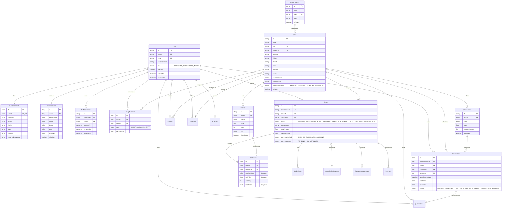

# Village1 Database Architecture & Entity Relationship (ER) Diagram

This document details the database schema design for **Village1**, optimized for MySQL in production with Prisma ORM and SQLite compatibility for local testing.

## Entity Relationship Diagram

## Key Architectural Rules

1. **Snapshots for Orders**:
   - `OrderItem` preserves `productName`, `unitPrice`, and `totalPrice` as historical immutable snapshots. Modifying or deleting product definitions in the shop catalog never alters existing completed orders.
2. **Multi-Shop Ownership & Membership**:
   - Handled via `ShopMember` with a unique constraint on `(shopId, userId)`. A user can own multiple shops and be authorized staff for another shop.
3. **No Negative Stock**:
   - Inventory decrements execute in database transactions with strict non-negative condition checks.
4. **Token Security**:
   - Refresh tokens are cryptographically hashed using SHA-256 before storage in `RefreshToken`. Automatic token reuse detection revokes all active tokens upon compromise.
5. **Role & Verification Separation**:
   - Only shops with `verificationStatus = APPROVED` and `isActive = true` are displayed for public commerce.
